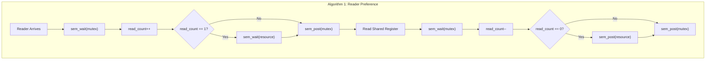
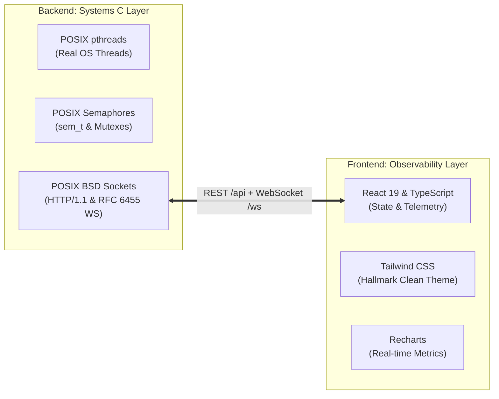
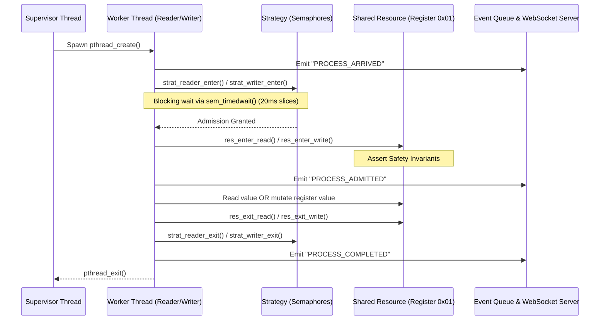

# SyncLab: Comprehensive System Documentation & Architectural Specification

An interactive Operating Systems Laboratory and High-Concurrency Concurrency Workbench for simulating, verifying, and analyzing the **Readers–Writers Synchronization Problem** under POSIX C and modern real-time visualization.

---

## 1. What is the Project?

**SyncLab** is an educational and systems-engineering workbench designed to demystify concurrent process synchronization. At its core, it tackles one of the foundational challenges in computer science: **The Readers–Writers Problem** (first formalized by P.J. Courtois, F. Heymans, and D.L. Parnas in 1971).

The project consists of:
1. **A Native C Engine (POSIX C11):** Built without third-party frameworks. It spawns genuine OS kernel threads (`pthread_t`), coordinates them via native POSIX semaphores (`sem_t`) and mutexes (`pthread_mutex_t`), serves a custom HTTP/1.1 REST API, and streams real-time state telemetry via an RFC 6455 WebSocket server written from scratch using POSIX sockets.
2. **Three Standalone Academic Demonstration Programs:** Pure, self-contained C implementations (`01_reader_preference.c`, `02_writer_preference.c`, `03_fair_fifo.c`) designed for command-line compilation, terminal-based tracing, and academic evaluation/viva examination.
3. **An Instrumentation-Grade Web Workbench:** A high-density frontend built with React 19, TypeScript, and Tailwind CSS following strict **Hallmark editorial design principles** (warm paper backgrounds, crisp hairline borders, zero neon glow, zero fake metrics). It renders physical hardware metaphors: the *Concurrent Reader Bus*, the *Protected Register 0x01*, and the *Exclusive Writer Clamp*.

---

## 2. What is the Core Idea?

In concurrent computing, multiple running processes or threads often require access to a shared data resource (such as a memory register, a database row, or a file):
* **Readers** only inspect the data. Multiple readers can safely access the resource simultaneously because reading does not mutate state.
* **Writers** modify the data. If a writer modifies the data while another thread (reader or writer) is accessing it, **data corruption, race conditions, and undefined behavior** occur.

### The Fundamental Dilemma: The Triad of Concurrency Hazards

```
                ┌───────────────────────────────────────────────┐
                │          THE READERS-WRITERS DILEMMA         │
                └──────────────────────┬────────────────────────┘
                                       │
         ┌─────────────────────────────┼─────────────────────────────┐
         ▼                             ▼                             ▼
┌───────────────────┐        ┌───────────────────┐        ┌───────────────────┐
│ Mutual Exclusion  │        │ Writer Starvation │        │ Reader Starvation │
│    Violations     │        │  (First Problem)  │        │ (Second Problem)  │
├───────────────────┤        ├───────────────────┤        ├───────────────────┤
│ Reader and writer │        │ Infinite stream of│        │ Arriving writers  │
│ simultaneously in │        │ readers locks out │        │ indefinitely block│
│ Critical Section. │        │ waiting writers.  │        │ waiting readers.  │
└───────────────────┘        └───────────────────┘        └───────────────────┘
```

The core idea of **SyncLab** is to implement the three canonical semaphore algorithms, subject them to real-time stress testing, and visualize the exact mechanics of lock acquisition, queueing, thread release, and starvation dynamics down to the millisecond.

---

## 3. Theoretical Concepts Explained

### 3.1 The Critical Section Problem
To achieve safe synchronization, any solution must satisfy three conditions formulated by Edsger Dijkstra:
1. **Mutual Exclusion:** If process $P$ is executing in its critical section, no other process may execute in its critical section (specifically, no reader overlaps a writer, and no two writers overlap).
2. **Progress:** If no process is in its critical section and some processes wish to enter, only those processes not in their remainder section can participate in deciding who enters next.
3. **Bounded Waiting:** A bound must exist on the number of times other processes are allowed to enter their critical sections after a process has made a request to enter and before that request is granted (preventing starvation).

### 3.2 Semaphores vs. Mutexes

| Feature | Mutex (`pthread_mutex_t`) | Semaphore (`sem_t`) |
|---|---|---|
| **Underlying Concept** | Ownership-based mutual exclusion lock. | Signaling counter mechanism. |
| **State Values** | Binary: Locked (0) or Unlocked (1). | Integer counter: $S \ge 0$. |
| **Ownership** | Only the thread that locked the mutex can unlock it. | Any thread can signal (`sem_post`) a semaphore. |
| **Primary Use in SyncLab** | Protects internal data structures and state counters (`state_lock`, `Resource.m`). | Controls thread admission gates (`mutex`, `mutex_w`, `read_try`, `order`, `resource`). |

### 3.3 The Three Classical Synchronization Algorithms



#### 1. Reader Preference (First Readers–Writers Problem)
* **Mechanics:** The first reader to arrive acquires the `resource` semaphore (`sem_wait(&resource)`). Subsequent readers bypass this semaphore and read concurrently. The last reader to leave releases `resource` (`sem_post(&resource)`). Writers attempt to acquire `resource` directly.
* **Consequence:** Writers must wait as long as at least one reader is active (`read_count > 0`). If new readers arrive before existing readers depart, waiting writers suffer **indefinite starvation**.

#### 2. Writer Preference (Second Readers–Writers Problem)
* **Mechanics:** An admission gate semaphore (`read_try`) is placed in front of arriving readers. As soon as a writer signals its intent to write (incrementing `write_count`), the first writer locks `read_try`. Arriving readers are blocked at `read_try` and cannot enter. Active readers finish, after which the waiting writer claims `resource`.
* **Consequence:** Writers take priority over incoming readers. A continuous influx of writers causes **reader starvation**.

#### 3. Fair FIFO Admission (Starvation-Free Turnstile)
* **Mechanics:** A single-ticket turnstile semaphore (`order`) precedes all requests. Every arriving process (reader or writer) acquires and passes through `order` in strict arrival order. Consecutive readers still read in parallel because a reader releases `order` immediately after registering its presence, but a reader arriving *after* a queued writer is held behind that writer at the turnstile.
* **Consequence:** Strictly fair First-In, First-Out request ordering. **Zero starvation** for both readers and writers.

---

## 4. Formal Safety Invariants

SyncLab verifies five formal mathematical invariants on every read and write cycle:

| Invariant | Formal Definition | Operational Guarantee |
|:---|:---|:---|
| **Invariant 1: Reader-Writer Exclusion** | $N_{\text{readers}} > 0 \implies W_{\text{active}} = \varnothing$ | No reader may hold a read lease while a writer holds an exclusive write lease. |
| **Invariant 2: Writer Mutual Exclusion** | $W_{\text{active}} \neq \varnothing \implies N_{\text{readers}} = 0 \land N_{\text{writers}} \le 1$ | At most one writer may access the shared resource at any given moment. |
| **Invariant 3: Reader Concurrency** | $N_{\text{readers}} \in [0, N_{\max}]$ | Multiple compatible reader threads may access the shared register concurrently ($N_{\max} = 100$). |
| **Invariant 4: Monotonic Versioning** | $v_{t+1} = v_t + 1 \quad (\forall \text{ committed writes})$ | Every committed write atomically increments the resource version counter ($v_1, v_2, \dots$). |
| **Invariant 5: Lease Integrity** | $\text{Process } P \text{ accesses } R \iff P \in \text{LeaseHolders}(R)$ | Thread operations require an acquired lease; clean cancellation releases all leases. |

$$
\begin{aligned}
\text{Safety Invariant 1 (Exclusion):} & \quad N_{\text{readers}} > 0 \implies W_{\text{active}} = \varnothing \\
\text{Safety Invariant 2 (Mutex):}     & \quad W_{\text{active}} \neq \varnothing \implies N_{\text{readers}} = 0 \\
\text{Safety Invariant 3 (Version):}   & \quad v_{t+1} = v_t + 1
\end{aligned}
$$

If any thread breaches an invariant, the engine raises an `InvariantViolationError` and registers an audit flag immediately.

---

## 5. What We Used & Why We Used It



### 5.1 Native POSIX C (C11)
* **What:** Pure C11 utilizing `<pthread.h>`, `<semaphore.h>`, `<stdatomic.h>`, and `<sys/socket.h>`.
* **Why:** 
  1. High-level languages (Python with GIL, Node.js with event-loop, Go with goroutines) introduce runtime schedulers that abstract or simulate threading. Pure POSIX C interacts directly with the OS kernel scheduler.
  2. Operating systems courses require direct exposure to `sem_wait`, `sem_post`, `sem_timedwait`, and memory barriers.
  3. Zero third-party dependencies: compile cleanly on any standard POSIX Linux/WSL environment with standard `gcc` and `make`.

### 5.2 Hand-Crafted HTTP & WebSocket Server in C
* **What:** A self-contained network server implementing HTTP/1.1 request parsing and the RFC 6455 WebSocket protocol (SHA-1 hashing + Base64 `Sec-WebSocket-Accept` handshake, binary frame masking/unmasking).
* **Why:** 
  1. Avoids bulky external web frameworks.
  2. Demonstrates systems programming competence by managing network sockets, non-blocking multiplexing, and thread-safe broadcast buffers using low-level system calls.

### 5.3 React 19, Vite & TypeScript
* **What:** Modern web frontend with typed state stores and sub-millisecond reactive rendering.
* **Why:**
  1. Managing 100 reader threads and 50 writer threads requires predictable, type-safe state transitions.
  2. Vite dev server provides proxying (`/api` and `/ws` to port 8000) for development workflows while compiling into a static bundle (`frontend/dist`) that the C binary serves directly in production.

### 5.4 Hallmark Editorial Design Tokens
* **What:** High-restraint light UI: `--color-paper: #F7F7F4`, `--color-surface: #FCFCFA`, `--color-rule: #E5E5DE`, and monospace telemetry typography (`Geist Mono`).
* **Why:**
  1. Avoids the "AI slop" trope (dark neon glows, cards inside cards, gradient buttons).
  2. Presents the simulator as a physical precision engineering instrument (oscilloscope / logic analyzer).

---

## 6. How We Used It: Technical Architecture

### 6.1 The Thread Lifecycle & Engine Architecture



### 6.2 Cooperative Mid-Flight Pause/Resume & Lease Safety

#### The Classical Trap:
Arbitrarily suspending an OS thread that holds an acquired mutex or semaphore via raw operating-system signals (`SIGSTOP` or Windows `SuspendThread`) induces **priority inversion and immediate deadlock**:
* Other threads waiting on that lock can never make progress.
* If the supervisor thread attempts to inspect shared state while a worker is frozen inside a mutex, the entire process freezes.

#### SyncLab's Solution: Cooperative Slice Barriers
Worker threads execute in timed slices:
1. All semaphore acquisitions call `acquire()` using `sem_timedwait(&sem, 20ms)` in a loop.
2. If paused while in the critical section, the worker **retains its acquired lease** (`resource` or `read_count`), freezing its progress bar without releasing locks prematurely.
3. When resumed, `Flag pause` signals workers to immediately resume execution.
4. **Time Dilation:** Cumulative paused durations (`total_paused_sec`) are subtracted from monotonic execution timestamps:

$$
\Delta t_{\text{effective}} = (t_{\text{now}} - t_{\text{start}}) - t_{\text{paused}}
$$

This ensures throughput, operation duration, and waiting-time metrics remain mathematically unskewed.

---

## 7. Performance & Telemetry Metrics Formulations

SyncLab continuously computes and streams empirical synchronization metrics:

### 1. Average Wait Time (W_avg)

The average duration threads spend waiting in queue before receiving admission:

$$
W_{\text{avg}} = \frac{1}{N} \sum_{i=1}^{N} \left( t_{\text{admitted}, i} - t_{\text{requested}, i} \right)
$$

### 2. Resource Occupancy Percentage (Ω)

The percentage of time the shared register was held by at least one active thread:

$$
\Omega = \left( \frac{T_{\text{occupied}}}{T_{\text{elapsed}}} \right) \times 100\%
$$

Where $T_{\text{occupied}}$ denotes total elapsed time with active readers ($N_{\text{readers}} > 0$) or an active writer.

### 3. Starvation Detection Heuristic

A starvation warning flag is triggered if writer waiting delay significantly outpaces reader service times:

$$
\text{MaxWriterWait} > 3 \times \text{AvgReaderWait} \quad \land \quad N_{\text{waiting}} > 0
$$

---

## 8. Summary of Project File Structure

```
synclab/
├── submission_c_files/               # Standalone C demonstration programs (for lab submission & viva)
│   ├── 01_reader_preference.c        # Standalone Algorithm 1 (Reader Preference)
│   ├── 02_writer_preference.c        # Standalone Algorithm 2 (Writer Preference)
│   ├── 03_fair_fifo.c                # Standalone Algorithm 3 (Fair FIFO Turnstile)
│   ├── Makefile                      # make | make run-all | make clean
│   └── README.md                     # Direct gcc commands & algorithm overview
├── backend/                          # Full Simulator C Backend (C11 / POSIX)
│   ├── Makefile                      # make | make run | make test | make clean
│   ├── src/
│   │   ├── server.c                  # HTTP + WebSocket server, REST routes, static hosting
│   │   ├── sync.h / sync.c           # Protected resource, 3 semaphore algorithms, simulation engine
│   │   └── util.h / util.c           # String buffer, JSON reader/writer, monotonic timers
│   └── tests/
│       ├── test_sync.c               # 15 C unit/concurrency tests (invariants, fairness, stress...)
│       ├── api_smoke.sh              # Starts server and runs end-to-end test suite
│       └── e2e_*.py                  # REST + WebSocket integration tests
├── frontend/                         # React UI (Vite + TypeScript + Tailwind CSS)
│   ├── src/                          # Views (Lab, Versus, Trace, Learn, Report) & Components
│   ├── package.json
│   └── vite.config.ts
├── start_all.bat                     # One-click Windows full-stack launcher
├── start_backend.bat                 # Launches C backend in WSL
├── start_backend.sh                  # Linux / WSL backend launcher
├── start_frontend.bat                # Launches Vite frontend dev server
└── README.md                         # Project overview and quickstart guide
```

---

## 9. Verification & Execution Guide

### Direct Terminal Execution (Standalone C Programs):
```bash
cd synclab/submission_c_files
make run-all
```

### Full-Stack Interactive Workbench:
1. Double-click [start_all.bat](file:///c:/Users/I%20Terish%20charan%20tej/Downloads/synclab_c_backend/synclab/start_all.bat) (or run `./start_backend.sh` in WSL and `npm run dev` in `frontend/`).
2. Open [http://localhost:5173/](http://localhost:5173/) in your web browser.
3. Switch between **Reader Preference**, **Writer Preference**, and **Fair FIFO Turnstile** to observe real-time thread scheduling, semaphore states, and starvation behavior.
